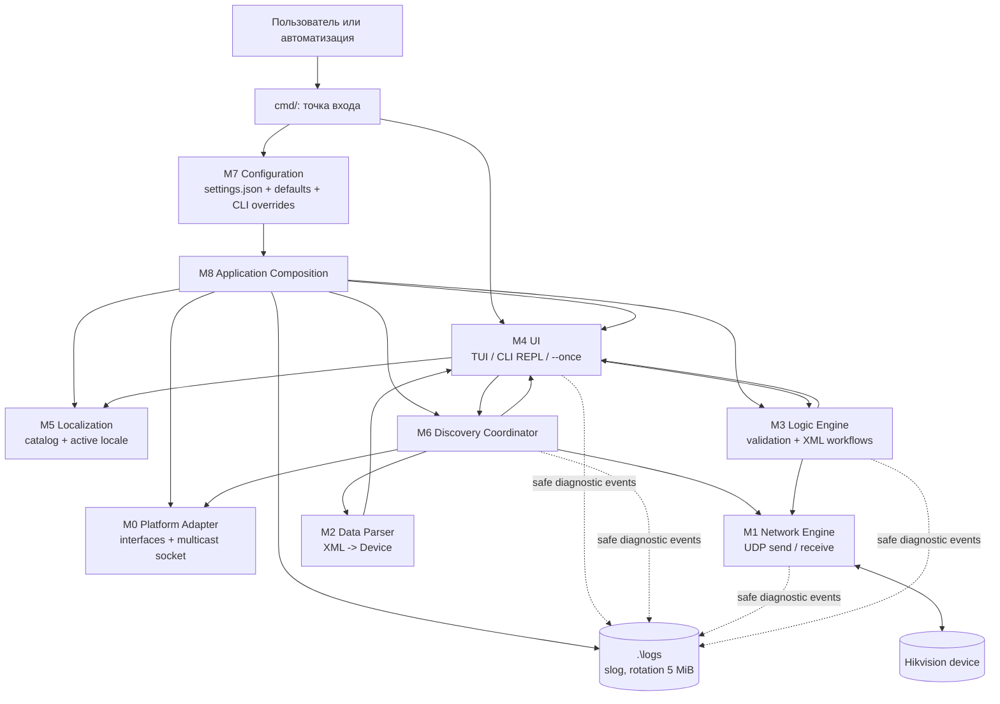
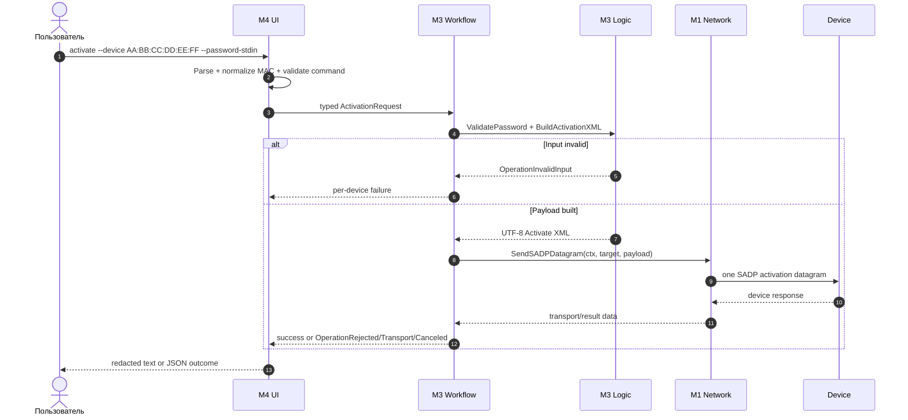
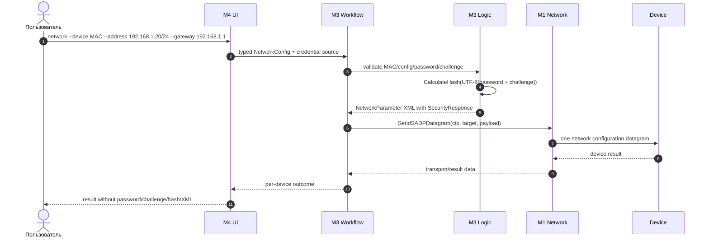
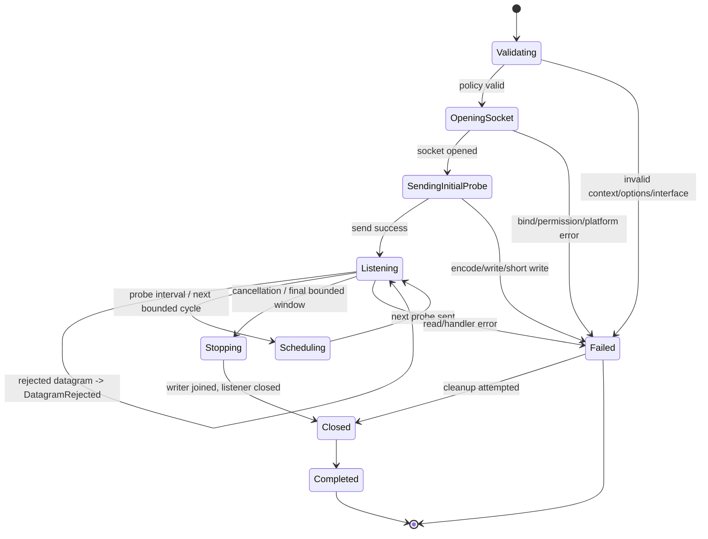

# Диаграмма работы и workflow SADP-handler

Документ сводит спецификации системы в единое представление: какие модули
участвуют в запуске, как проходят данные и действия пользователя, где
возникают ошибки и как завершается операция.

> Статус: это модель целевой архитектуры. Go-реализация приложения ещё не
> начата. Discovery основан на проверенном Python-поведенческом референсе;
> сквозные `activate` и `network` требуют отдельной реализации и проверки
> ответов устройств.

## 1. Границы системы



### Ответственность модулей

| Участок | Что делает | Чего не делает |
|---|---|---|
| M7 | Читает `settings.json`, проверяет схему, применяет defaults | Не подменяет ошибочный существующий файл defaults |
| M8 | Один раз собирает типизированный `RuntimeConfig` и зависимости | Не передаёт JSON-схему нижележащим пакетам |
| M0 | Перечисляет интерфейсы и открывает multicast-соединение | Не отправляет probe и не разбирает XML |
| M1 | Передаёт/принимает UDP-датаграммы, соблюдает cancellation и лимиты | Не принимает бизнес-решения по устройству |
| M2 | Проверяет размер/XML/обязательные поля и строит `Device` | Не выполняет сетевые действия |
| M6 | Координирует одну discovery-сессию на одном интерфейсе | Не выбирает интерфейсы и не дедуплицирует устройства |
| M3 | Валидирует команды, строит activation/network XML и возвращает исходы | Не отвечает за UI или платформенный socket setup |
| M4 | Парсит ввод, вызывает typed services и показывает результат | Не открывает sockets и не строит SADP XML |
| M5 | Загружает и атомарно переключает каталоги локализации | Не управляет CLI и не рисует терминал |

## 2. Запуск приложения и подготовка runtime


**Правила отказа:** malformed/invalid present `settings.json`, невозможный
путь локализации, ошибка создания `.\\logs`, неподдерживаемый режим или
невалидные CLI-флаги завершают запуск до открытия сетевого сокета. В JSON
режиме результат команды идёт в `stdout`, prompt и диагностика не смешиваются
с ним.

## 3. Discovery: передача информации и действий

```mermaid
sequenceDiagram
    autonumber
    actor U as Пользователь
    participant UI as M4 UI
    participant D as M6 Discovery
    participant AD as M0 Adapter
    participant N as M1 Network
    participant P as M2 Parser
    participant K as Device

    U->>UI: discover --interface 4 --timeout 5s --repeat 1
    UI->>UI: Parse command -> typed Command
    UI->>D: DiscoverOnInterface(ctx, iface, options, handler)
    D->>D: Validate policy and datagram size
    D->>AD: OpenMulticast(iface, 239.255.255.250:37020, TTL=64)
    AD-->>D: PacketConn (ownership transferred to listener)
    D->>N: SendInquiryProbe(ctx, conn, target)
    N->>K: UDP multicast XML Probe
    par Receive loop
        K-->>N: UDP ProbeMatch or Hello datagram + sender
        N->>D: []byte, net.Addr
        D->>P: ParseAdvertisement(payload, maxSize)
        alt Valid advertisement
            P-->>D: parser.Device
            D->>UI: Event{DeviceFound, Device, Sender, ObservedAt}
            UI-->>U: device row / text / JSON result
        else Invalid, oversized or incomplete datagram
            P-->>D: parse error
            D->>UI: Event{DatagramRejected, Sender, Err}
            UI-->>U: safe diagnostic; continue listening
        end
    and Schedule
        D->>N: next probe immediately or at ProbeInterval
        N->>K: one independent UDP inquiry datagram
    end
    U->>UI: Ctrl+C / quit / timeout complete
    UI->>D: cancel context
    D->>N: stop and join scheduled writer
    D->>N: cancel listener context
    N->>N: close transferred connection
    N-->>D: nil on normal cancellation or typed error
    D-->>UI: final result / partial events / error
```

### Формат данных discovery

| Шаг | Данные | Инварианты |
|---|---|---|
| UI → M6 | `Interface`, `DiscoveryOptions`, `context.Context` | Один явно выбранный интерфейс; timing policy ровно continuous или bounded |
| M6 → M0 | `MulticastOptions` | По умолчанию `239.255.255.250:37020`, TTL `64` |
| M1 → M6 | `payload []byte`, `net.Addr` | Payload недоверенный; sender сохраняется; размер ограничен |
| M2 → M6 | `parser.Device` или error | Только валидированные обязательные поля |
| M6 → UI | `DeviceFound` или `DatagramRejected` | Ошибка parse не роняет сессию, если handler её принял |

Probe отправляется один раз за вызов `SendInquiryProbe`. Повторение по
таймеру является расписанием приложения и не означает корреляцию UUID,
гарантированную повторную передачу или причинную связь с конкретным `Hello`.

## 4. Workflow команд управления устройством

Сквозной transport/result workflow для этих операций должен быть реализован
до включения команд. Ниже показан целевой поток, а не утверждение о текущей
готовности приложения.





Для нескольких устройств workflow создаёт отдельный результат на каждый MAC:
ошибка одного устройства не должна скрывать успешные или неуспешные результаты
остальных. Отсутствующий challenge — отказ `fail closed`, plaintext fallback
не допускается.

## 5. Модель состояний сессии



Нормальное завершение возвращает `nil` только после остановки writer и
закрытия connection. При ошибке listener во время записи coordinator сохраняет
обе причины; ошибки классифицируются typed errors, а не анализом текста.

## 6. Сквозная симуляция одного bounded discovery цикла

Пример использует условные данные и не содержит реальных credentials.

| Время | Инициатор | Действие | Передаваемая информация | Результат |
|---:|---|---|---|---|
| t0 | UI | Разбор команды | `interface=4`, `timeout=5s`, `repeat=1` | Typed command |
| t1 | M7/M8 | Подготовка runtime | `maxDatagramSize=1500`, group/port/TTL | `DiscoveryOptions` |
| t2 | M6 → M0 | Открытие сокета | interface index/name + multicast options | `PacketConn` |
| t3 | M6 → M1 | Первый probe | XML `<Probe>` с UUID, `Types=inquiry`, `ResponseMode=2` | UDP write |
| t4 | Device → M1 | Ответ | bytes, sender `192.0.2.10:37020` | datagram accepted |
| t5 | M1 → M2 | Парсинг | payload + limit 1500 | `Device{MAC, IPv4Address, ...}` |
| t6 | M2 → M6 → UI | Событие | `DeviceFound`, sender, timestamp | строка/JSON устройства |
| t7 | M6 | Ожидание | bounded receive window до 5 секунд | новые события или timeout |
| t8 | UI → M6 | Отмена/окончание | `context.Cancel()` либо final cycle | stop scheduling |
| t9 | M6 → M1 | Cleanup | join writer, cancel listener | close connection |
| t10 | M6 → UI | Завершение | partial results + typed error, если есть | exit code `0`/`1` |

## 7. Наблюдаемость и безопасность

- В журнал попадают только безопасные атрибуты: стадия, тип ошибки, размер
  датаграммы, интерфейс, sender/target, count и duration.
- Не журналируются пароли, challenge, hash, полные XML/JSON и содержимое
  сетевых payload.
- `context.Context` владеет отменой; переданный в `Listen` connection закрывает
  сам listener. Не допускаются бесконечные retry и goroutine per datagram.
- Ошибка конфигурации, bind/write/read/parse/handler и cancellation различаются
  через typed errors и `errors.Is`/`errors.As`.
- Presentation не меняет режим во время процесса: TUI, REPL и one-shot выбираются
  один раз при запуске.

