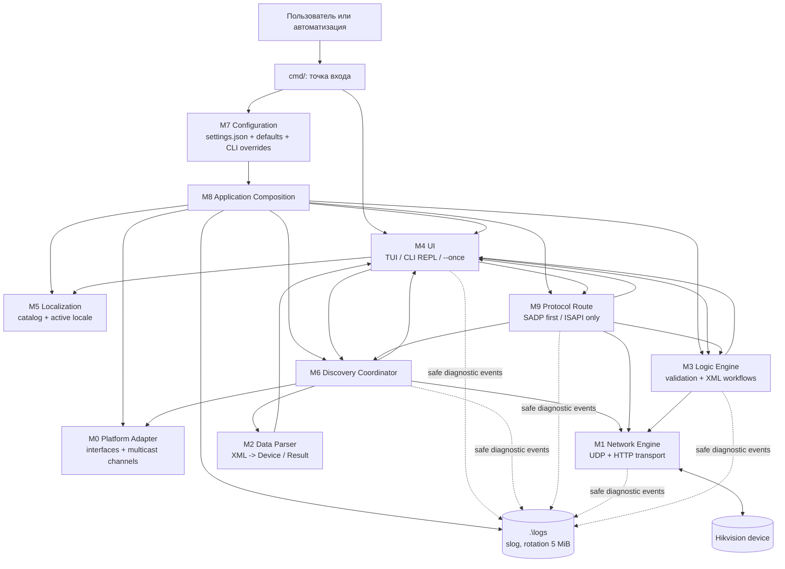
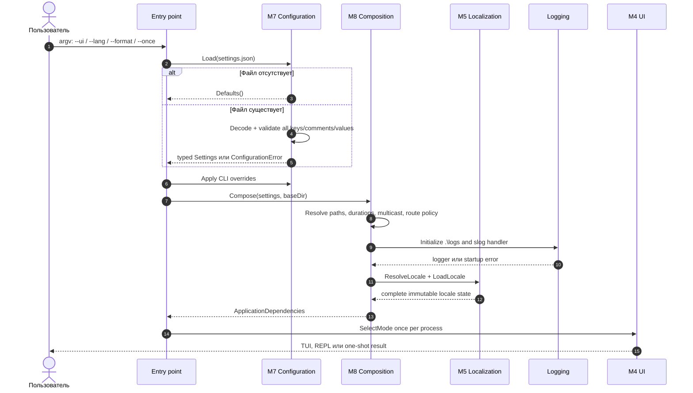
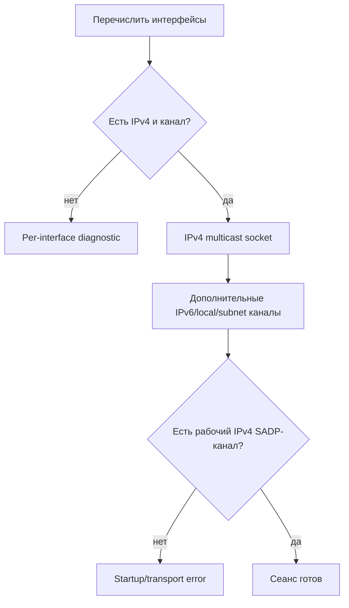
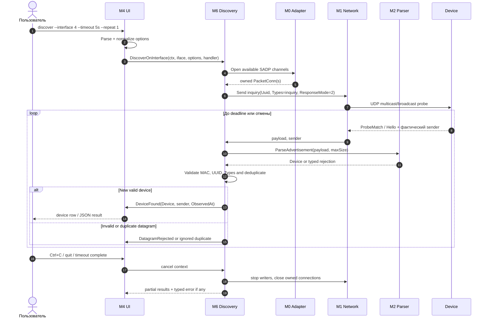
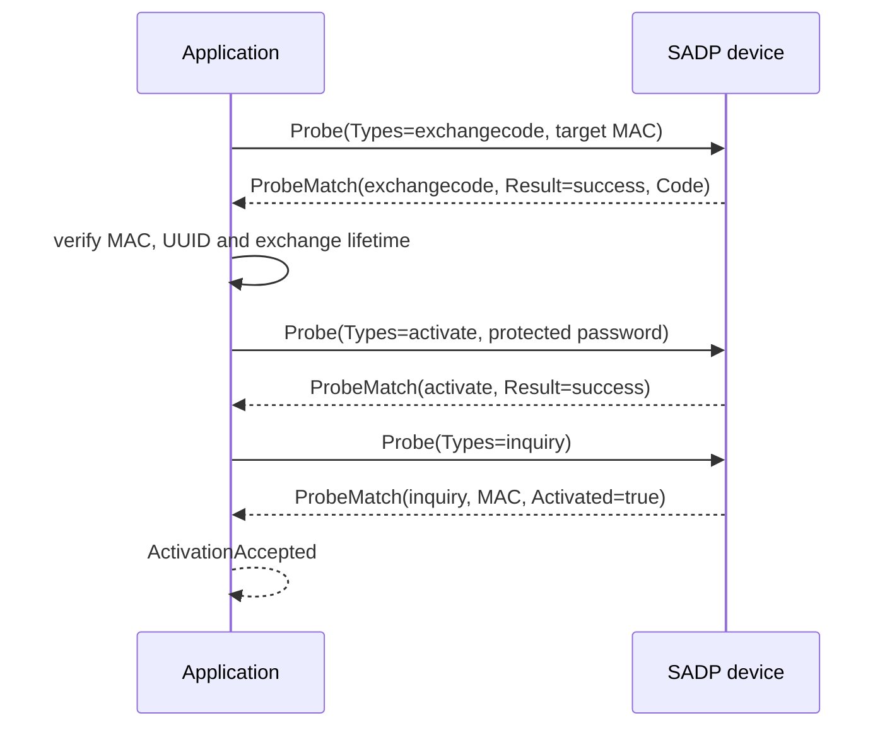
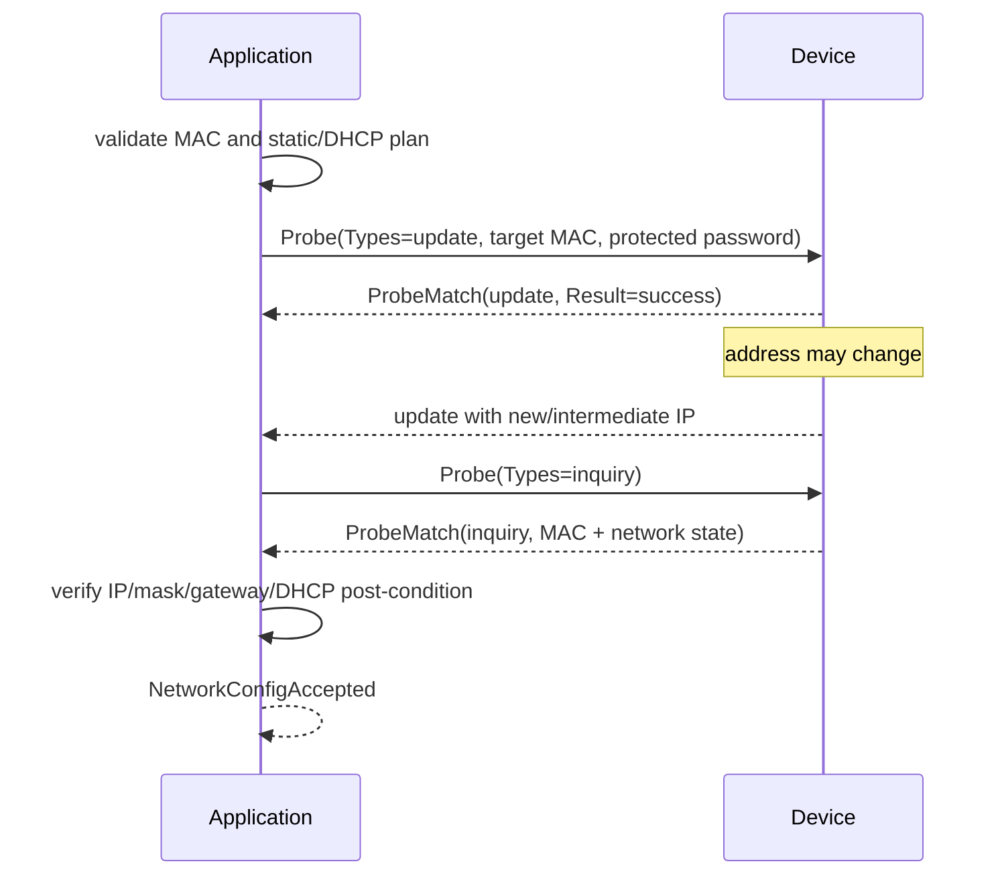
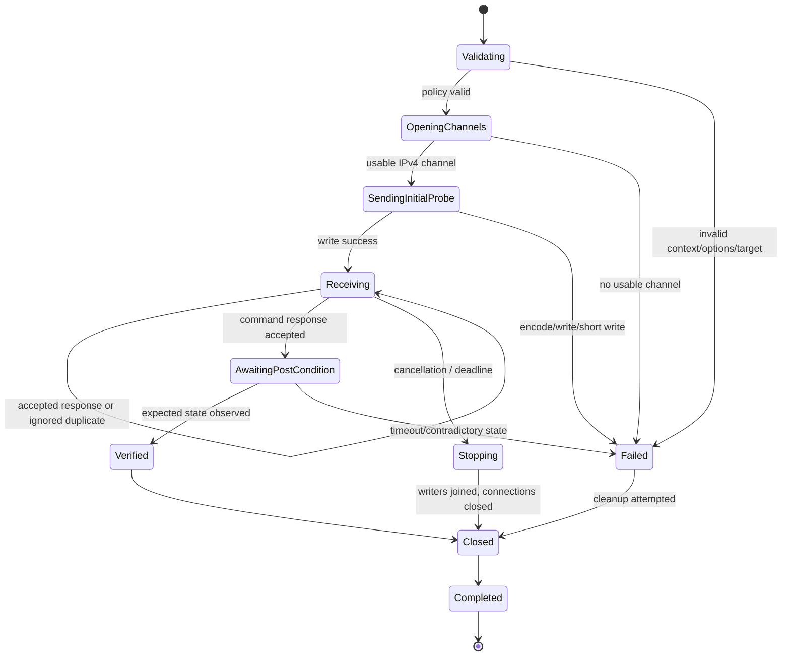

# Диаграмма работы и workflow SADP-handler

Документ сводит актуальные спецификации системы, подтверждённые наблюдения
SADP SDK и доверенные процедуры ISAPI в единое представление: какие модули
участвуют в запуске, как проходят данные и действия пользователя, где
возникают ошибки и как проверяется результат.

> Статус: целевая модель с подтверждёнными wire-фактами. Discovery и
> базовая композиция приложения реализованы частично. Команды изменения
> устройства должны включаться только после появления соответствующего
> wire-profile и post-condition проверки; неизвестные криптографические
> форматы нельзя восполнять предположениями.

## 1. Границы системы



### Ответственность модулей

| Участок | Что делает | Чего не делает |
|---|---|---|
| M7 | Читает `settings.json`, проверяет схему, применяет defaults | Не подменяет ошибочный существующий файл defaults |
| M8 | Один раз собирает типизированный `RuntimeConfig` и зависимости | Не передаёт JSON-схему нижележащим пакетам |
| M0 | Проверяет интерфейсы и открывает доступные IPv4 multicast/subnet-каналы | Не отправляет команды и не разбирает XML |
| M1 | Передаёт/принимает UDP и HTTP(S), соблюдает cancellation и лимиты | Не принимает бизнес-решения и не выбирает fallback |
| M2 | Проверяет размер/XML/обязательные поля и строит `Device`/результат | Не выполняет сетевые действия |
| M6 | Координирует discovery и коррелирует ответы по MAC/UUID/Types | Не выбирает протокол для операции |
| M9 | Выбирает SADP или ISAPI и классифицирует конечный результат | Не меняет маршрутизацию, firewall или адрес интерфейса |
| M3 | Валидирует команды, строит поддержанные payload и post-condition | Не отвечает за UI или platform socket setup |
| M4 | Парсит ввод, вызывает typed services и показывает результат | Не открывает sockets и не строит SADP XML |
| M5 | Загружает и атомарно переключает каталоги локализации | Не управляет CLI и не рисует терминал |

SADP и ISAPI являются разными протоколами. `Activated=true` из SADP
является признаком состояния устройства, но не заменяет проверку
авторизованного ISAPI-доступа после активации.

## 2. Запуск приложения и подготовка runtime



До открытия сетевого сокета завершаются проверка конфигурации, путей,
локализации, логирования, режима UI и CLI-флагов. В JSON-режиме `stdout`
содержит только результат команды; prompt и диагностика туда не попадают.

## 3. Подготовка SADP-сеанса

Для каждого локального интерфейса приложение независимо пытается создать
пригодный IPv4 SADP-канал. Ошибка Bluetooth, Wi-Fi Direct, pcap или другого
непригодного интерфейса не должна останавливать сеанс, если остался хотя бы
один рабочий IPv4-канал.



Основной IPv4 endpoint — `239.255.255.250:37020`; IPv6 и локальные каналы
являются дополнительными. Идентичность устройства всегда сохраняется по
MAC, а IP является только текущим адресом управления.

## 4. Discovery: передача информации и действий



Критерии принятия `ProbeMatch`:

1. payload не пустой и не превышает лимит;
2. XML корректен, корень — `ProbeMatch` или подтверждённый `Hello`;
3. `Types` соответствует ожидаемому типу;
4. MAC является корректным EUI-48;
5. IPv4 корректен либо находится в разрешённом промежуточном DHCP-состоянии
   (`0.0.0.0` или `169.254.x.x`);
6. фактический `sender` сохранён отдельно от адреса внутри XML;
7. ответ связан с ожидаемыми MAC/UUID, а дубликаты loopback не создают новую
   операцию.

Повторная отправка probe по расписанию не означает гарантированную доставку
или причинную связь с конкретным `Hello`.

## 5. Общий workflow команды изменения

Одна команда может породить несколько UDP-сообщений: непосредственный ответ,
`update`, `inquiry` и локальную копию через loopback. Поэтому transport
читает ответы до deadline, а не только первый пакет.

```mermaid
sequenceDiagram
    autonumber
    actor U as Пользователь
    participant UI as M4 UI
    participant R as M9 Route
    participant D as M6/M1 Transport
    participant L as M3 Logic
    participant K as Device

    U->>UI: команда с MAC и параметрами
    UI->>L: typed request + credential source
    L->>L: validate target, policy and operation
    R->>R: choose SADP first or explicit ISAPI only
    R->>D: send supported request
    D->>K: one or more datagrams / HTTP requests
    K-->>D: responses until deadline
    D->>D: correlate MAC/UUID/Types; ignore duplicates
    D->>L: classified response
    L->>D: post-condition inquiry or authorized read
    D-->>R: verified or unverified outcome
    R-->>UI: per-device typed result
    UI-->>U: redacted text or JSON outcome
```

Успех публикуется только после проверки post-condition. Для bulk-операции
результат создаётся отдельно для каждого MAC; отказ одной цели не скрывает
результаты остальных.

### Правила M9

- По умолчанию используется `sadp_first`; `isapi_only` выбирается явно.
- Fallback к ISAPI разрешён только при классифицированной недоступности SADP,
  подтверждённом маршруте к адресу и поддержке требуемой операции.
- Отказ устройства, ошибка авторизации, некорректный ответ, отмена, timeout
  и ошибка post-condition являются конечными исходами и не запускают fallback.
- M9 не меняет таблицу маршрутизации, firewall или сетевые пространства.
- Ответ нельзя принимать только потому, что его sender совпадает со старым
  IP: после изменения допустим переход старый IP → новый IP, а при DHCP —
  `0.0.0.0`/`169.254.x.x` → новый адрес. MAC остаётся якорем идентичности.

## 6. Активация устройства

### 6.1. SADP-профиль



Последовательность `exchangecode → activate → update/inquiry` подтверждена,
но точные поля `exchangecode`, `Code` и защищённого пароля ещё не
восстановлены. Нельзя переносить в raw SADP RSA/AES-механику ISAPI.
Если wire-profile не подтверждён, результатом является
`unsupported/compatibility error`, а не plaintext fallback.

### 6.2. ISAPI-профиль

Для проверенного профиля допустима последовательность:

```text
POST /ISAPI/Security/challenge
PUT  /ISAPI/System/activate
GET  /SDK/activateStatus
```

Профиль использует RSA-1024 с `e=65537`, challenge и AES-128-ECB, но это
моделеспецифичная процедура, а не универсальный контракт. Успех требует
`statusCode=1`/`subStatusCode=ok`, затем `Activated=true` и успешного
авторизованного `GET /ISAPI/System/deviceInfo`.

### 6.3. Проверка активации

```text
sadp = discover_by_target_mac(target_mac)
require sadp.activated == true
device = digest_get("/ISAPI/System/deviceInfo", new_credentials)
require device.status is 2xx
require parsed identity matches target MAC or serial
```

Один только HTTP `200`, SADP `success` или установленное поле
`Activated=true` не доказывают рабочую административную учётную запись.

## 7. Настройка сети

### 7.1. SADP

Для подтверждённого SADP-профиля используется `Types=update` с MAC цели,
после чего ожидаются новые `update` и `inquiry`. Реальный SDK использует
`<Password bSalt="true">`, а не текущий универсальный
`<SecurityResponse>`. До получения wire-fixture защищённого поля операция
не включается.



### 7.2. ISAPI

До записи интерфейса нужно прочитать его текущую конфигурацию:

```text
GET /ISAPI/System/Network/interfaces
GET /ISAPI/System/Network/interfaces/{interface-id}
PUT /ISAPI/System/Network/interfaces/{interface-id}
PUT /ISAPI/System/reboot                 # только если явно требуется
```

Изменяются только проверенные адресные поля и режим DHCP/static; обязательные
поля ответа устройства сохраняются. После разрыва соединения результат
содержит MAC/serial цели, запрошенный план, наблюдаемый новый адрес и
состояние проверки, но не credentials. Повторный авторизованный
`deviceInfo` и сетевое состояние должны соответствовать плану.

## 8. Дополнительные процедуры

Контрольные вопросы — отдельная опциональная операция, а не обязательный
этап активации:

```text
getsecurityquestion
  -> exchangecode
  -> setsecurityquestion
  -> update/inquiry
```

Она выполняется только при наличии capability и явном запросе пользователя.
Формат защищённых ответов и число вопросов не считаются универсальными.
Аналогично, `SetHCPlatform` и Hik-Connect требуют отдельного wire-profile и
не добавляются в активацию автоматически.

## 9. Состояния сессии



Нормальное завершение возвращает `nil` только после остановки writer и
закрытия connection. При ошибке listener во время записи сохраняются обе
причины; ошибки классифицируются typed errors, а не анализом текста.

## 10. Наблюдаемость и безопасность

Разрешённый диагностический минимум: тип операции, UUID, MAC, интерфейс,
наблюдаемый sender, старый/новый IP, DHCP-состояние, result code, duration и
стадия ошибки.

Нельзя журналировать или включать в результат пароль, `Password` и его
ciphertext, challenge plaintext, RSA private key, AES-ключ, `Salt`, `Code`,
ответы на контрольные вопросы и полный XML с чувствительными полями.

`context.Context` владеет отменой. Не допускаются бесконечные retry,
goroutine per datagram и success-shaped fallback. Ошибки configuration,
bind/write/read/parse/handler, authorization, compatibility и cancellation
различаются через typed errors и `errors.Is`/`errors.As`.
