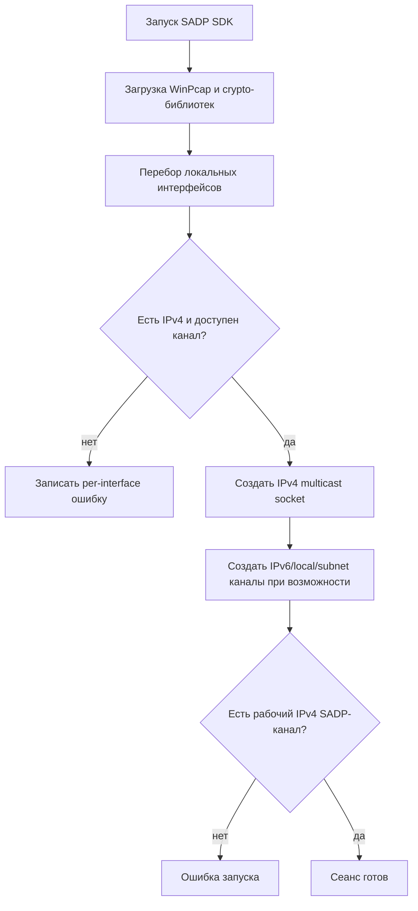
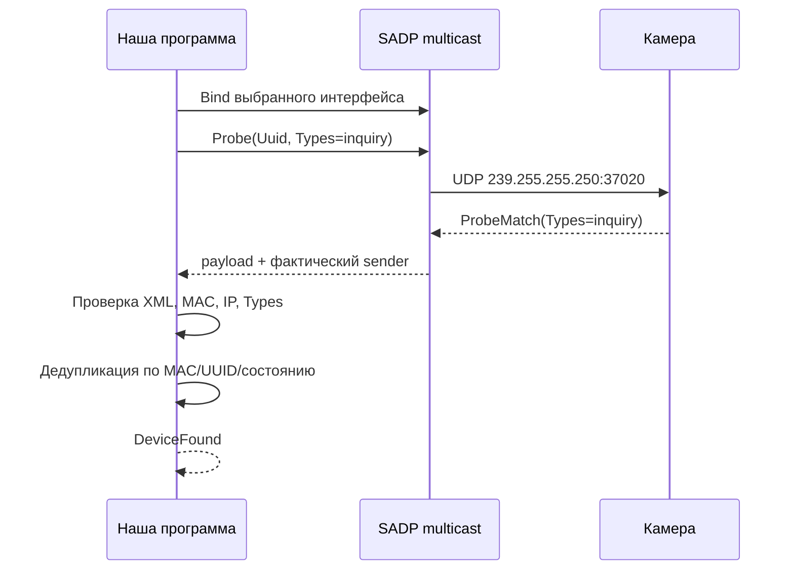
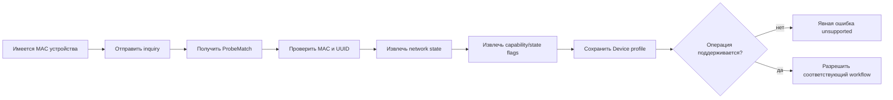
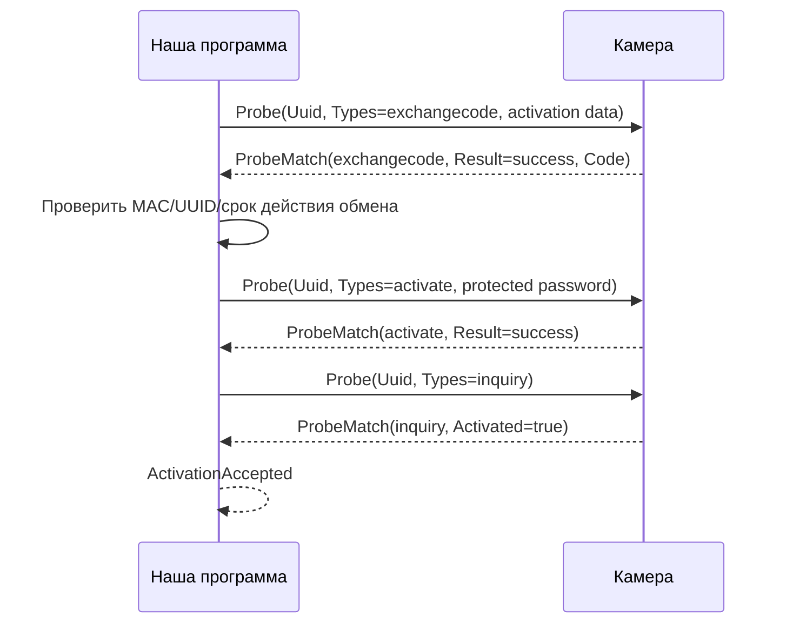
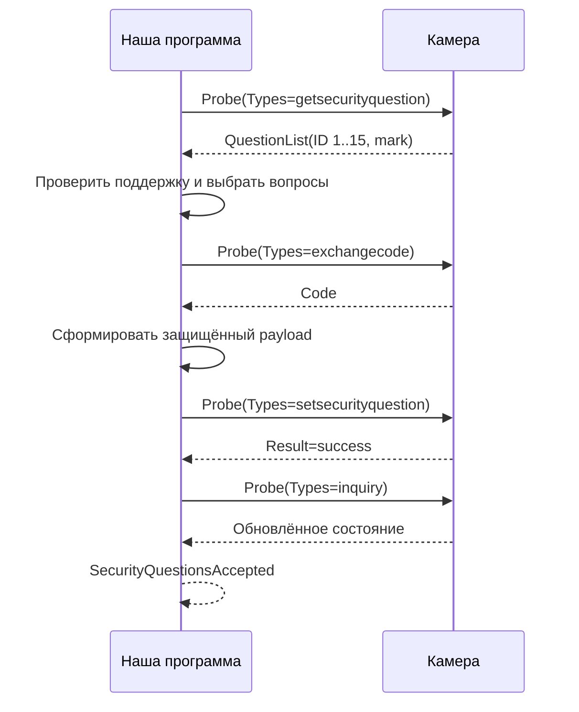
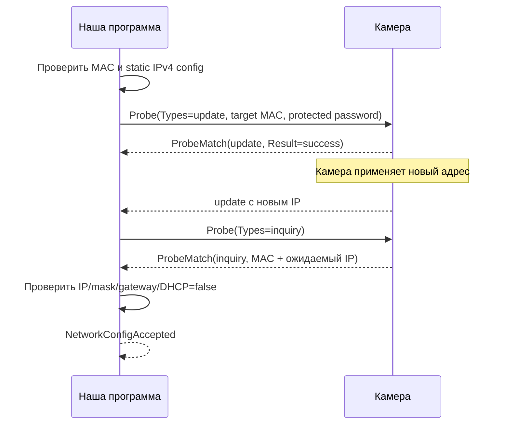
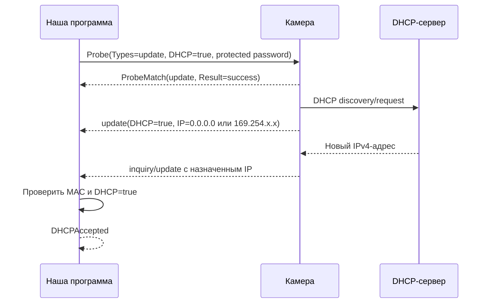
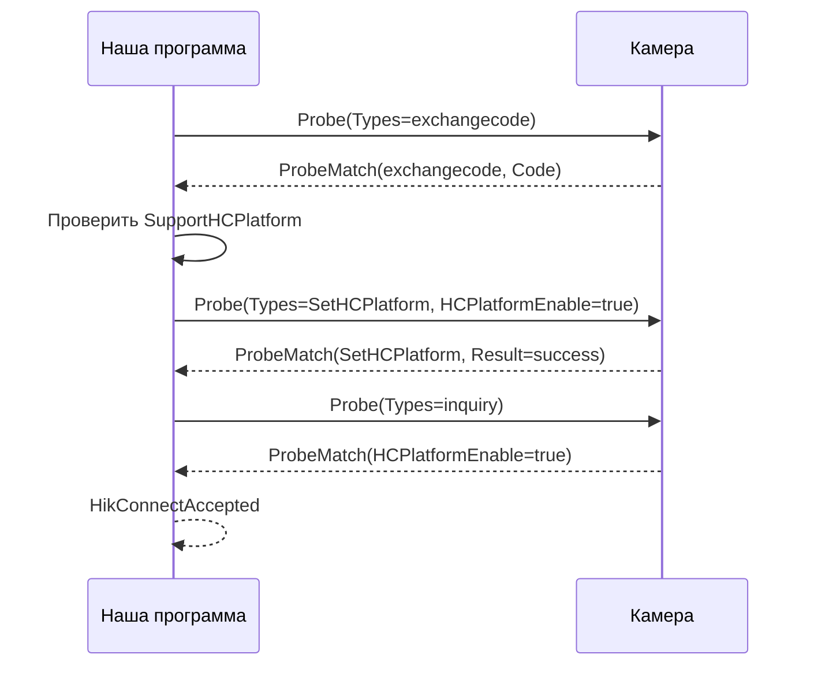

# SADP: сводный анализ протокола и рабочих процедур

**Дата анализа:** 28.10.2026  
**Статус:** исследовательский отчёт; подтверждённые wire-факты отделены от
гипотез и незавершённых реконструкций  
**Объект:** Hikvision SADP SDK 4.6.0.151, камера
DS-2CD1021-I, прошивка V5.5.801 build 210701

## 1. Источники и границы достоверности

Использованы:

- сетевой перехват
  [SADP-Activation-Net-DHCP-HC.txt](../../../../../HikSDK/Hikvision_sdk/SADP-Activation-Net-DHCP-HC.txt);
- лог SADP SDK
  [SdkLog_20261028_214108754_w.log](../../../../../HikSDK/Hikvision_sdk/SdkLog_20261028_214108754_w.log);
- лог зависимого OTAPDCM SDK
  [OTAPDCM_20261028_214108928_w.log](../../../../../HikSDK/Hikvision_sdk/OTAPDCM_20261028_214108928_w.log);
- текущая Go-спецификация SADP/ISAPI
  [SADP_ISAPI_TRUSTED_PIPELINES.md](../procedures/SADP_ISAPI_TRUSTED_PIPELINES.md);
- текущая реализация сетевого транспорта
  [mutation_transport.go](../../../internal/network/mutation_transport.go);
- текущая реализация XML-билдеров
  [build_activation_xml.go](../../../internal/logic/build_activation_xml.go);
- текущий SADP-парсер
  [parser.go](../../../internal/parser/parser.go).

Сетевой перехват подтверждает фактические сообщения, которые были
переданы по сети. Логи SDK дополнительно показывают исходный XML до
бинарной упаковки, внутренний выбор интерфейса и порядок вызовов SDK.
Лог не является полной спецификацией: он содержит только операции,
выполненные в конкретном сеансе.

Секреты, пароли, ответы на контрольные вопросы и ciphertext намеренно не
воспроизводятся в отчёте.

## 2. Краткий итог

SADP в исследованном сеансе — самостоятельный локальный UDP-протокол:

| Свойство | Подтверждённое значение |
|---|---|
| Основной IPv4 multicast | `239.255.255.250:37020` |
| IPv6 multicast | `FF02::C:37020` |
| Локальный IPC/multicast SDK | `239.255.255.251:47020` на loopback |
| Формат полезной нагрузки | XML `Probe`/`ProbeMatch`, иногда внутри бинарного заголовка |
| Идентичность устройства | MAC, например `94-e1-ac-dd-a3-6f` |
| Идентификатор операции | UUID сообщения |
| Тип операции | `<Types>` |
| Основные типы | `inquiry`, `update`, `activate`, `exchangecode`, `getsecurityquestion`, `setsecurityquestion`, `SetHCPlatform` |
| Основной рабочий интерфейс ПК | `192.168.1.250` |

Главные инженерные выводы:

1. IP-адрес устройства изменяем и не может быть постоянным ключом
   корреляции. Главным ключом является MAC.
2. Одна команда может породить несколько UDP-сообщений: непосредственный
   ответ, `update`, `inquiry`, дубликат через loopback.
3. Для изменения сети реальный SDK использует
   `<Password bSalt="true">`, а не текущий в Go формат
   `<SecurityResponse>`.
4. После `success` требуется проверка post-condition через последующее
   объявление устройства.
5. DHCP имеет промежуточные состояния с `0.0.0.0` и `169.254.x.x`.
6. Активация, контрольные вопросы и Hik-Connect используют отдельные
   SADP-типы и отдельный этап `exchangecode`.

## 3. Подготовка SADP-сеанса

### 3.1. Инициализация SDK

SDK загружает:

- `wpcap.dll`;
- `HCNetSDK.dll`;
- `HCOTAPDCM.dll`;
- `libssl-3-x64.dll`;
- `libcrypto-3-x64.dll`.

Версия SADP SDK:

```text
HCSADPSDK 4.6.0.151 build20261010
```

Для каждого обнаруженного интерфейса SDK пытается создать:

1. IPv4 multicast socket;
2. IPv6 multicast socket;
3. локальный IPv4 multicast socket;
4. subnet UDP socket;
5. при возможности pcap/Ethernet канал.

Интерфейсы без IPv4 или с недоступным pcap могут завершить отдельную
инициализацию ошибкой, но это не останавливает работу на пригодном
интерфейсе.

### 3.2. Подтверждённый выбор интерфейса

Рабочий интерфейс:

```text
Adapter: USB2.0 Ethernet Adapter
IPv4:   192.168.1.250
MAC:    c8-17-f5-fa-71-42
```

Внутренние ошибки для Bluetooth, Wi-Fi Direct и других интерфейсов не
должны автоматически превращаться в ошибку всей операции, если хотя бы
один пригодный IPv4-канал успешно запущен.

### 3.3. Схема подготовки



## 4. Общая структура SADP-сообщения

На логическом уровне запрос имеет форму:

```xml
<?xml version="1.0" encoding="utf-8"?>
<Probe>
  <Uuid>operation-uuid</Uuid>
  <Types>operation-type</Types>
  ...
</Probe>
```

Ответ имеет форму:

```xml
<?xml version="1.0" encoding="UTF-8"?>
<ProbeMatch>
  <Uuid>response-uuid</Uuid>
  <Types>response-type</Types>
  <Result>success</Result>
  ...
</ProbeMatch>
```

Для обычного объявления устройства присутствуют:

```xml
<MAC>94-e1-ac-dd-a3-6f</MAC>
<IPv4Address>192.168.1.64</IPv4Address>
<IPv4SubnetMask>255.255.255.0</IPv4SubnetMask>
<IPv4Gateway>192.168.1.1</IPv4Gateway>
<DHCP>false</DHCP>
<CommandPort>8000</CommandPort>
<HttpPort>80</HttpPort>
<Activated>true</Activated>
```

Также встречаются capability/state-поля:

```xml
<Encrypt>true</Encrypt>
<SupportSecurityQuestion>true</SupportSecurityQuestion>
<SupportHCPlatform>true</SupportHCPlatform>
<HCPlatformEnable>true</HCPlatformEnable>
<PasswordResetAbility>true</PasswordResetAbility>
<DeviceLock>true</DeviceLock>
<Salt>...</Salt>
```

Во всех проверенных XML-ответах поле `<Activated>` присутствует и содержит
булево значение `true` или `false`. Различие поколений устройств по наличию
или отсутствию этого поля не выявлено; состояние активации следует
извлекать из него независимо от модели и поколения firmware.

`Salt`, зашифрованные поля и ответы на контрольные вопросы не должны
попадать в журналы.

## 5. Процедура A — обнаружение устройства

### 5.1. Подготовка и отправка inquiry

Из сетевого перехвата подтверждён запрос вида:

```xml
<Probe>
  <Uuid>...</Uuid>
  <Types>inquiry</Types>
  <ResponseMode>2</ResponseMode>
</Probe>
```

Он отправляется на IPv4 multicast `239.255.255.250:37020`.
SDK отправляет inquiry через каждый пригодный канал, поэтому в логах
может быть несколько частичных успехов и отказов.

### 5.2. Ответ устройства

Устройство отвечает:

```xml
<ProbeMatch>
  <Uuid>...</Uuid>
  <Types>inquiry</Types>
  <DeviceType>142601</DeviceType>
  <DeviceDescription>DS-2CD1021-I</DeviceDescription>
  <DeviceSN>...</DeviceSN>
  <CommandPort>8000</CommandPort>
  <HttpPort>80</HttpPort>
  <MAC>94-e1-ac-dd-a3-6f</MAC>
  <IPv4Address>192.168.1.64</IPv4Address>
  <IPv4SubnetMask>255.255.255.0</IPv4SubnetMask>
  <IPv4Gateway>192.168.1.1</IPv4Gateway>
  <DHCP>false</DHCP>
  <Activated>true</Activated>
  ...
</ProbeMatch>
```

### 5.3. Критерии успешного обнаружения

Минимум:

1. пакет не пустой и не превышает лимит;
2. XML корректен;
3. корень — `ProbeMatch` или подтверждённый `Hello`;
4. `Types` соответствует ожидаемому типу;
5. MAC корректен и является EUI-48;
6. IPv4 корректен либо разрешено промежуточное DHCP-состояние;
7. sender сохранён отдельно от адреса, указанного внутри XML.

### 5.4. Workflow



## 6. Процедура B — запрос информации и capability

В raw SADP отдельный универсальный тип `capabilities` в исследованном
сеансе не подтверждён. Информация о возможностях приходит в обычном
`inquiry`/`update`-ответе.

Подтверждённые признаки:

```xml
<SupportSecurityQuestion>true</SupportSecurityQuestion>
<SupportHCPlatform>true</SupportHCPlatform>
<Encrypt>true</Encrypt>
<PasswordResetAbility>true</PasswordResetAbility>
```

В бинарной части SDK также сохраняет capability-массивы:

```text
bySupport
bySupport1
bySupport2
```

Значения отдельных битов пока не расшифрованы.

### Workflow



## 7. Процедура C — активация

### 7.1. Подтверждённые сообщения

В перехвате видна последовательность:

```text
exchangecode -> activate -> update/inquiry
```

Ответы имеют форму:

```xml
<ProbeMatch>
  <Uuid>...</Uuid>
  <Types>exchangecode</Types>
  <Result>success</Result>
  <Code>...</Code>
</ProbeMatch>
```

затем:

```xml
<ProbeMatch>
  <Uuid>...</Uuid>
  <Types>activate</Types>
  <Result>success</Result>
</ProbeMatch>
```

Проверка результата выполняется по последующему объявлению:

```xml
<Activated>true</Activated>
```

### 7.2. Логика завершённой процедуры



### 7.3. Что неизвестно

Не восстановлены с достаточной уверенностью:

- точная форма исходного `exchangecode`;
- алгоритм формирования `<Code>`;
- точная форма защищённого поля активации;
- связь между `Salt` из объявления и `Code`;
- обязательность контрольных вопросов для всех прошивок — не подтверждена и
  опровергается практикой на устройствах разных поколений; вопросы могут
  вообще не устанавливаться;
- точная форма ответа для других моделей и firmware.

ISAPI-активация является отдельной процедурой и описана в
[ISAPI_ENCRYPTED_USER_FIELDS.md](ISAPI_ENCRYPTED_USER_FIELDS.md). Нельзя
подставлять ISAPI challenge/RSA/AES-механику в raw SADP без отдельной
wire-fixture.

## 8. Процедура D — контрольные вопросы

### 8.1. Чтение списка вопросов

После активации камера отвечает:

```xml
<ProbeMatch>
  <Uuid>...</Uuid>
  <MAC>94-e1-ac-dd-a3-6f</MAC>
  <Types>getsecurityquestion</Types>
  <Result>success</Result>
  <QuestionList>
    <Question><ID>1</ID><mark>false</mark></Question>
    ...
    <Question><ID>15</ID><mark>false</mark></Question>
  </QuestionList>
</ProbeMatch>
```

В наблюдаемом сеансе подтверждено наличие ID `1..15`.

Рекомендуемая модель:

```go
type SecurityQuestion struct {
    ID       int
    Selected bool
}
```

### 8.2. Установка

Наблюдаемая последовательность:

```text
getsecurityquestion
  -> exchangecode
  -> setsecurityquestion
  -> update/inquiry
```

Ответ команды:

```xml
<ProbeMatch>
  <Uuid>...</Uuid>
  <MAC>94-e1-ac-dd-a3-6f</MAC>
  <Types>setsecurityquestion</Types>
  <Result>success</Result>
</ProbeMatch>
```

### 8.3. Workflow



Настройка контрольных вопросов является отдельной необязательной
процедурой. Если пользователь её не запросил или устройство не объявляет
соответствующую capability, активация не должна включать
`getsecurityquestion`, дополнительный `exchangecode` или
`setsecurityquestion`.

Типичный поддерживаемый вариант — отдельная команда с тремя парами
«вопрос-ответ». Количество, идентификаторы вопросов и точный формат
команды зависят от модели и прошивки; значение «три» нельзя считать
универсальным wire-требованием.

### 8.4. Неизвестные данные

По имеющимся материалам не установлены:

- точные имена полей исходного запроса;
- как передаются ответы `11`, `22`, `33`;
- алгоритм защиты ответов;
- является ли `exchangecode` общим для активации и вопросов;
- требуется ли отдельная проверка `mark=true` после записи.

Нельзя реализовывать эту процедуру по одному только успешному ответу:
нужна проверка повторным `getsecurityquestion` либо подтверждённым
`inquiry`-состоянием. Если пользователь не выбирал настройку вопросов,
их отсутствие не является ошибкой и не должно блокировать завершение
активации.

## 9. Процедура E — изменение статического IP

### 9.1. Подтверждённый SDK-вызов

Логирует:

```text
SADP_ModifyDeviceNetParam_V40
byDhcpEnable=0
IPv4Address=192.168.1.64
IPv4Gateway=192.168.1.1
IPv4SubNetMask=255.255.255.0
IPv6Address=::
IPv6Gateway=::
IPv6MaskLen=64
CommandPort=8000
HttpPort=80
```

Исходный XML использует:

```xml
<Types>update</Types>
<PWErrorParse>true</PWErrorParse>
<MAC>...</MAC>
<Password bSalt="true">...</Password>
<IPv4Address>...</IPv4Address>
<CommandPort>8000</CommandPort>
<IPv4SubnetMask>...</IPv4SubnetMask>
<IPv4Gateway>...</IPv4Gateway>
<IPv6Address>::</IPv6Address>
<IPv6Gateway>::</IPv6Gateway>
<IPv6MaskLen>64</IPv6MaskLen>
<DHCP>false</DHCP>
<HttpPort>80</HttpPort>
```

### 9.2. Завершение

Непосредственный ответ `success` не является единственной проверкой.
SDK получает несколько `update`, затем запускает новый `inquiry`.

Переходы IP в эксперименте:

```text
192.168.1.64 -> 192.168.1.65 -> 192.168.1.64
```

При этом MAC сохраняется.

### 9.3. Workflow



### 9.4. Корреляция

Ответ может прийти:

- со старого IP;
- с нового IP;
- через `127.0.0.1` как локальная копия SDK;
- несколько раз.

Ключ корреляции должен включать MAC и UUID, но не требовать совпадения
sender IP.

## 10. Процедура F — включение и отключение DHCP

### 10.1. Включение DHCP

Подтверждённый SDK-вызов:

```text
byDhcpEnable=1
IPv4Address=169.254.30.51
IPv4Gateway=0.0.0.0
IPv4SubNetMask=255.255.0.0
DHCP=true
```

В сетевом перехвате также наблюдалось состояние:

```xml
<IPv4Address>0.0.0.0</IPv4Address>
<IPv4SubnetMask>0.0.0.0</IPv4SubnetMask>
<IPv4Gateway>0.0.0.0</IPv4Gateway>
<DHCP>true</DHCP>
```

Поэтому допустимы временные состояния:

```text
DHCP=true + 0.0.0.0
DHCP=true + 169.254.x.x
DHCP=true + выданный DHCP-адрес
```

`0.0.0.0` нельзя использовать как destination, но нельзя отвергать
такое объявление как повреждённое.

### 10.2. Workflow



### 10.3. Отключение DHCP

Процедура аналогична статическому изменению IP:

```text
DHCP=true
  -> Probe(update, DHCP=false, address/mask/gateway)
  -> update
  -> inquiry
  -> проверка DHCP=false и статических полей
```

### 10.4. Несоответствие текущего парсера

Текущий [ParseAdvertisement](../../../internal/parser/parser.go)
отвергает `0.0.0.0`. Это нужно изменить с учётом `DHCP=true`, сохранив
строгую проверку для обычного `DHCP=false`.

## 11. Процедура G — Hik-Connect

### 11.1. Подтверждённая последовательность

В перехвате видны:

```text
exchangecode
SetHCPlatform
inquiry
```

Ответ изменения:

```xml
<ProbeMatch>
  <Uuid>...</Uuid>
  <MAC>94-e1-ac-dd-a3-6f</MAC>
  <Types>SetHCPlatform</Types>
  <HCPlatformEnable>true</HCPlatformEnable>
  <Result>success</Result>
</ProbeMatch>
```

Последующее объявление содержит:

```xml
<SupportHCPlatform>true</SupportHCPlatform>
<HCPlatformEnable>true</HCPlatformEnable>
```

### 11.2. Workflow



Для отключения ожидается та же схема с
`HCPlatformEnable=false`, но отдельный успешный wire-fixture отключения
в материалах не представлен.

### 11.3. Ошибка firmware

В ранних ответах наблюдалось значение:

```xml
<HCPlatformEnable>flase</HCPlatformEnable>
```

Это не следует автоматически трактовать как `false`. Допустимые состояния
в модели должны включать `true`, `false` и `unknown`.

## 12. Защита команды изменения сети

Лог SADP SDK показывает:

```xml
<Password bSalt="true">Base64(ciphertext)</Password>
```

В текущей Go-реализации [BuildNetworkXML](../../../internal/logic/build_activation_xml.go)
используется:

```xml
<SecurityResponse>sha256(password + challenge)</SecurityResponse>
```

Это нельзя считать универсально совместимым с исследованным SDK. Для
конкретного устройства из лога подтверждён только следующий факт:

```text
Probe + Password[bSalt=true] + PWErrorParse=true
```

Алгоритм формирования ciphertext пока не идентифицирован. До получения
контролируемых пар plaintext/ciphertext нельзя безопасно реализовывать
криптографию по догадке.

## 13. Требования к корреляции и приёму

Текущий транспорт [SADPMutationTransport](../../../internal/network/mutation_transport.go)
читает один первый ответ. Для исследованного поведения этого недостаточно.

Нужен цикл:

```text
send command
  -> receive until deadline
  -> decode message type
  -> verify MAC
  -> verify operation UUID where available
  -> ignore duplicate/local copy
  -> accept only expected Types
  -> wait for post-condition inquiry/update
```

Нельзя требовать:

```text
response sender IP == original target IP
```

Нужно разрешать:

```text
старый IP -> новый IP
169.254.x.x -> DHCP IP
device sender -> 127.0.0.1 duplicate
```

## 14. Безопасность и журналирование

Нельзя логировать:

- пароль;
- `<Password>` и его ciphertext;
- `<Code>` из `exchangecode`;
- `Salt`;
- ответы на контрольные вопросы;
- полные исходящие XML с чувствительными полями.

Разрешённый диагностический минимум:

```text
operation type
operation UUID
MAC
observed sender
old/new IP
DHCP state
result code
elapsed time
error stage
```

Ошибки загрузки необязательных библиотек или интерфейсов должны быть
привязаны к конкретному каналу. Наличие `ERR` в общем SDK-логе само по себе
не означает провал SADP-операции: в исследованном сеансе после нескольких
ошибок интерфейсов `ParseDevResponse` завершился успешно.

## 15. Что уже можно реализовать уверенно

| Процедура | Состояние знаний | Реализация |
|---|---|---|
| Инициализация выбранного IPv4-интерфейса | Подтверждено | Можно реализовать |
| `inquiry` обнаружение | Подтверждено | Уже частично реализовано |
| Разбор `ProbeMatch` | Подтверждено | Расширить поля DHCP/network/capability |
| Изменение статического IP | Форма XML подтверждена, защита не подтверждена | Нужен wire profile и crypto fixture |
| Включение DHCP | Последовательность подтверждена | Нужны промежуточные IP-состояния |
| Отключение DHCP | Практически подтверждено | Нужна отдельная проверка post-condition |
| Активация | Типы и порядок подтверждены | Защищённое поле и exchangecode не восстановлены; вопросы не обязательны |
| Чтение вопросов | Подтверждено для поддерживающих устройств | Можно реализовать как отдельную опциональную операцию |
| Установка вопросов | Результат подтверждён, запрос неизвестен | Нужен дополнительный capture; не включать автоматически в активацию |
| Hik-Connect enable | Типы и порядок подтверждены | Payload protection не восстановлена |
| Hik-Connect disable | Предполагается симметрично | Нужен отдельный capture |

## 16. Что остаётся неизвестным

Отдельно зафиксированы следующие неопределённости:

1. алгоритм и ключевывод для `<Password bSalt="true">`;
2. точная форма исходного `exchangecode`;
3. связь `Salt` объявления с защищённым payload;
4. точный формат активационного пароля в raw SADP;
5. исходный XML установки контрольных вопросов;
6. криптографическая защита ответов `11`, `22`, `33`;
7. точная семантика трёх массивов `bySupport`;
8. универсальность формата для других моделей и firmware;
9. обязательность `ResponseMode=2` для всех устройств;
10. различия между multicast, subnet и pcap-режимами на разных Windows-сетях.

Эти пункты нельзя закрывать предположениями или переносом механики ISAPI.

## 17. Рекомендуемый следующий порядок работ

### P0 — корректность транспорта

1. Ввести корреляцию по MAC/UUID/Types.
2. Перейти от чтения одного пакета к приёму до deadline.
3. Добавить дедупликацию loopback-копий.
4. Реализовать post-condition verification.
5. Разрешить DHCP-состояния `0.0.0.0` и `169.254.x.x`.

### P1 — модели и wire profiles

1. Расширить `Device` сетевыми и capability-полями.
2. Добавить типизированные операции `exchangecode`, `getsecurityquestion`,
   `setsecurityquestion`, `SetHCPlatform`.
3. Разделить legacy/hash и salted-password wire profiles.
4. Сохранить raw capability bytes без преждевременной расшифровки.

### P2 — криптография и неизвестные операции

1. Получить контролируемые SDK-логи с известным паролем.
2. Сопоставить plaintext и ciphertext для нескольких повторов.
3. Получить исходные payload `activate`, `setsecurityquestion` и
   `SetHCPlatform`.
4. Добавить wire-fixtures и только после этого реализовывать
   соответствующие криптографические билдеры.
